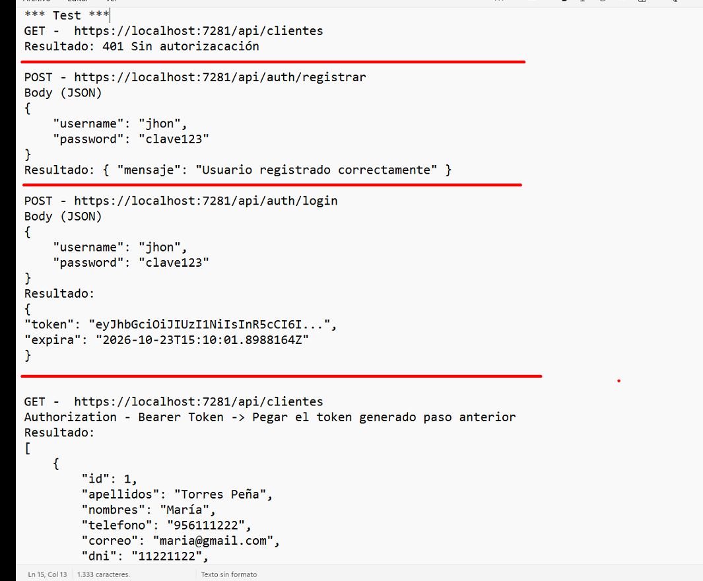
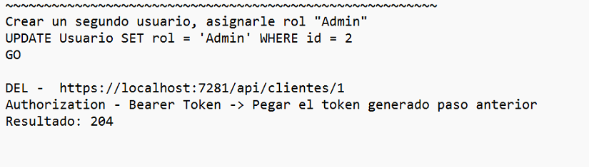

# ClientesApi

Web API RESTful robusta y escalable desarrollada con **ASP.NET Core (.NET 10)**, **Entity Framework Core**, **SQL Server** y seguridad basada en **JSON Web Tokens (JWT)** con cifrado de contraseñas mediante **BCrypt**. Incluye documentación interactiva integrada con **Scalar API Reference**.

---

## Tabla de Contenidos
- [Caracteristicas Principales](#caracteristicas-principales)
- [Tecnologias Utilizadas](#tecnologias-utilizadas)
- [Estructura del Proyecto](#estructura-del-proyecto)
- [Base de Datos](#base-de-datos)
- [Configuracion y Puesta en Marcha](#configuracion-y-puesta-en-marcha)
- [Catalogo de Endpoints](#catalogo-de-endpoints)
- [Guia y Evidencia de Pruebas](#guia-y-evidencia-de-pruebas)
- [Autor](#autor)

---

## Caracteristicas Principales

- **Autenticacion y Autorizacion JWT:** Emision de tokens de acceso seguros y validacion en cada solicitud protegida.
- **Seguridad con BCrypt:** Hasheo y verificacion de contraseñas sin almacenamiento en texto plano.
- **Control de Acceso Basado en Roles (RBAC):** Restricciones granulares (por ejemplo, eliminacion exclusiva para administradores `[Authorize(Roles = "Admin")]`).
- **Gestion de Clientes:** CRUD integral con validacion de unicidad de DNI y control de concurrencia.
- **Gestion de Productos:** Registro, actualizacion y consulta con validacion de numero de serie y precision monetaria.
- **Documentacion Interactiva:** Soporte nativo para OpenAPI y visor moderno con **Scalar UI**.

---

## Tecnologias Utilizadas

- **Framework:** .NET 10 (C# 13)
- **Persistencia / ORM:** Entity Framework Core 10 (SQL Server Provider)
- **Base de Datos:** Microsoft SQL Server
- **Seguridad:**
  - `Microsoft.AspNetCore.Authentication.JwtBearer` (v10.0.13)
  - `BCrypt.Net-Next` (v4.2.0)
  - `System.IdentityModel.Tokens.Jwt`
- **Documentacion API:** `Scalar.AspNetCore` (v2.18.0) y `Microsoft.AspNetCore.OpenApi`

---

## Estructura del Proyecto

```text
ClientesApi/
├── Controllers/
│   ├── AuthController.cs            # Endpoints de Registro y Login
│   ├── ClientesController.cs        # CRUD de Clientes con proteccion JWT
│   └── ProductosController.cs       # CRUD de Productos
├── Data/
│   └── AppDbContext.cs               # Contexto EF Core y DbSets
├── Models/
│   ├── AuthDtos.cs                  # DTOs: RegistroRequest y LoginRequest
│   ├── Cliente.cs                   # Entidad Cliente (tabla clientes)
│   ├── Productos.cs                 # Entidad Productos (tabla productos)
│   └── Usuario.cs                   # Entidad Usuario (tabla Usuario)
├── docs/
│   └── screenshots/                 # Capturas de evidencia de pruebas
├── appsettings.json                 # Cadena de conexion y configuracion JWT
└── Program.cs                       # Pipeline, inyeccion de dependencias y middlewares
```

---

## Base de Datos

El sistema se conecta a SQL Server mediante la base de datos `DemoClientes`. Las tablas principales son:

```sql
--Tabla de Usuarios
CREATE TABLE Usuario (
    id INT IDENTITY(1,1) PRIMARY KEY,
    username NVARCHAR(50) NOT NULL UNIQUE,
    passwordhash NVARCHAR(200) NOT NULL,
    rol NVARCHAR(30) NOT NULL DEFAULT 'Usuario'
);

--Tabla de Clientes
CREATE TABLE clientes (
    id INT IDENTITY(1,1) PRIMARY KEY,
    apellidos NVARCHAR(70) NOT NULL,
    nombres NVARCHAR(70) NOT NULL,
    telefono NVARCHAR(9) NOT NULL,
    correo NVARCHAR(70) NOT NULL,
    dni NVARCHAR(8) NOT NULL UNIQUE,
    direccion NVARCHAR(150) NOT NULL
);

--Tabla de Productos
CREATE TABLE productos (
    id INT IDENTITY(1,1) PRIMARY KEY,
    nombre NVARCHAR(100) NOT NULL,
    descripcion NVARCHAR(100) NOT NULL,
    precio DECIMAL(7,2) NOT NULL,
    garantia TINYINT NOT NULL,
    numserie NVARCHAR(40) NULL
);
```

---

## Configuracion y Puesta en Marcha

### 1. Clonar el repositorio
```bash
git clone https://github.com/Pineda-25/ClientesApi.git
cd ClientesApi
```

### 2. Configurar `appsettings.json`
Verifica la cadena de conexion a tu instancia de SQL Server y los parametros JWT:

```json
{
  "ConnectionStrings": {
    "DefaultConnection": "Server=localhost;Database=DemoClientes;User Id=sa;Password=tu_password;TrustServerCertificate=True;"
  },
  "Jwt": {
    "Key": "IngresaUnaClaveDeNoMenos32CaracteresProtecionAPppWebJWT!2026.",
    "Issuer": "CLientesApi",
    "Audience": "ClientesApiUsuarios",
    "ExpireMinutes": 60
  }
}
```

### 3. Restaurar dependencias y ejecutar
```bash
dotnet restore
dotnet build
dotnet run --project ClientesApi/ClientesApi.csproj
```

La API iniciara en `https://localhost:7281` (o en el puerto asignado en tu `launchSettings.json`). Puedes acceder a la documentacion interactiva de Scalar en:
`https://localhost:7281/scalar/v1`

---

## Catalogo de Endpoints

### Autenticacion (`/api/auth`)
| Metodo | Endpoint | Descripcion | Acceso |
|---|---|---|---|
| `POST` | `/api/auth/registrar` | Registra un nuevo usuario con contraseña cifrada (BCrypt) | Publico |
| `POST` | `/api/auth/login` | Valida credenciales y genera el Bearer Token JWT | Publico |

### Clientes (`/api/clientes`)
| Metodo | Endpoint | Descripcion | Acceso |
|---|---|---|---|
| `GET` | `/api/clientes` | Obtiene el listado completo de clientes | Requiere JWT |
| `GET` | `/api/clientes/{id}` | Busca y retorna un cliente por su ID | Requiere JWT |
| `POST` | `/api/clientes` | Registra un nuevo cliente (valida DNI duplicado) | Requiere JWT |
| `PUT` | `/api/clientes/{id}` | Actualiza los datos de un cliente existente | Requiere JWT |
| `DELETE` | `/api/clientes/{id}` | Elimina un cliente por su ID | Requiere rol **Admin** |

### Productos (`/api/productos`)
| Metodo | Endpoint | Descripcion | Acceso |
|---|---|---|---|
| `GET` | `/api/productos` | Obtiene el catalogo de productos | Publico |
| `GET` | `/api/productos/{id}` | Obtiene el detalle de un producto por ID | Publico |
| `POST` | `/api/productos` | Registra un nuevo producto (valida serie duplicada) | Publico |
| `PUT` | `/api/productos/{id}` | Actualiza los datos del producto | Publico |
| `DELETE` | `/api/productos/{id}` | Elimina un producto por su ID | Publico |

---

## Guia y Evidencia de Pruebas

A continuacion se detalla el ciclo completo de validacion y pruebas de seguridad realizadas en la API.

### Paso 1: Intento de acceso sin autorizacion
Se realiza una consulta inicial sin adjuntar token de seguridad:
- **Peticion:** `GET https://localhost:7281/api/clientes`
- **Resultado:** `401 Unauthorized` (Acceso denegado correctamente por el middleware de seguridad).

---

### Paso 2: Registro de nuevo usuario
Se da de alta el usuario con sus credenciales:
- **Peticion:** `POST https://localhost:7281/api/auth/registrar`
- **Headers:** `Content-Type: application/json`
- **Body:**
```json
{
  "username": "junior.pineda",
  "password": "clave123"
}
```
- **Resultado:** `200 OK`
```json
{
  "mensaje": "Usuario registrado correctamente "
}
```

---

### Paso 3: Inicio de sesion (Login) y obtencion de JWT
El usuario se autentica para obtener su token con firma criptografica:
- **Peticion:** `POST https://localhost:7281/api/auth/login`
- **Headers:** `Content-Type: application/json`
- **Body:**
```json
{
  "username": "junior.pineda",
  "password": "clave123"
}
```
- **Resultado:** `200 OK`
```json
{
  "token": "eyJhbGciOiJIUzI1NiIsInR5cCI6IkpXVCJ9...",
  "expira": "2026-10-23T15:10:01.8988164Z"
}
```

---

### Paso 4: Consulta autenticada con Bearer Token
Utilizando el token obtenido, se realiza la consulta a los recursos protegidos:
- **Peticion:** `GET https://localhost:7281/api/clientes`
- **Headers:** `Authorization: Bearer <TOKEN_OBTENIDO>`
- **Resultado:** `200 OK` (Retorna la coleccion completa de clientes).
```json
[
  {
    "id": 1,
    "apellidos": "Torres Peña",
    "nombres": "María",
    "telefono": "956111222",
    "correo": "maria@gmail.com",
    "dni": "11221122",
    "direccion": "Av. Principal 123"
  }
]
```



---

### Paso 5: Control de roles y eliminacion administrativa (Admin)
Para operaciones criticas como la eliminacion de un cliente, se requiere rol de **Admin**.

1. Asignar rol de administrador en SQL Server:
```sql
UPDATE Usuario 
SET rol = 'Admin' 
WHERE username = 'junior.pineda';
GO
```

2. Volver a iniciar sesion para generar un nuevo token con el claim de rol `Admin`.
3. Ejecutar la eliminacion del cliente:
- **Peticion:** `DELETE https://localhost:7281/api/clientes/1`
- **Headers:** `Authorization: Bearer <TOKEN_ADMIN>`
- **Resultado:** `204 No Content` (Eliminacion procesada exitosamente).



---

## Autor

- **Desarrollador:** Junior Pineda ([@Pineda-25](https://github.com/Pineda-25))
- **Correo:** juniorpineda2511@gmail.com
